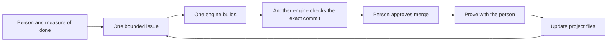

# A brain for working with AI agents: plain files, one loop, any harness.

## 2. The picture

## 3. What you get

Seven project files hold the goal, plan, state, tasks, decisions, lessons and
setup. Five playbooks and an index explain the loop. Issue forms, a pull request
template and automated checks make work reviewable. A fictional reading list
shows filled files. Everything here is newly written generic text.

## 4. Five minutes with the example project

1. Read [the goal](projects/example-reading-list/GOAL.md) and its measure of done.
2. Read [the state](projects/example-reading-list/STATE.md) for the next action.
3. Compare [the tasks](projects/example-reading-list/TASKS.md) with the roadmap.
4. Answer [the six questions](playbooks/hand-over.md) from the files.

The example is fictional. Its build, checks and acceptance have not happened.

## 5. Start and continue

Follow [SETUP](SETUP.md), then [HOW-TO-USE](HOW-TO-USE.md).
[INSIGHTS](INSIGHTS.md) explains the five habits; [AGENTS](AGENTS.md) gives the
agent rules. [The playbook index](playbooks/INDEX.md) links each procedure.

## 6. Boundaries

This is not a framework, a memory service or autonomous risky merging. The owner
controls access, approvals and consequential actions. A different engine checks
agent work, or a person checks when only one engine is available.

## 7. What is proven

Proof run 1: pending. Completion requires green CI, a private scrub, a fresh
session answering all six questions, and the throwaway fake-key pull request
failing for the planted value before it is closed unmerged. Local checks alone
do not establish these results. Record the receipt and date here after the run.

## 8. Credits and licence

[NOTICE](NOTICE.md) records the three adapted methods and their sources.
The template is under the MIT licence (see [LICENSE](LICENSE)).
